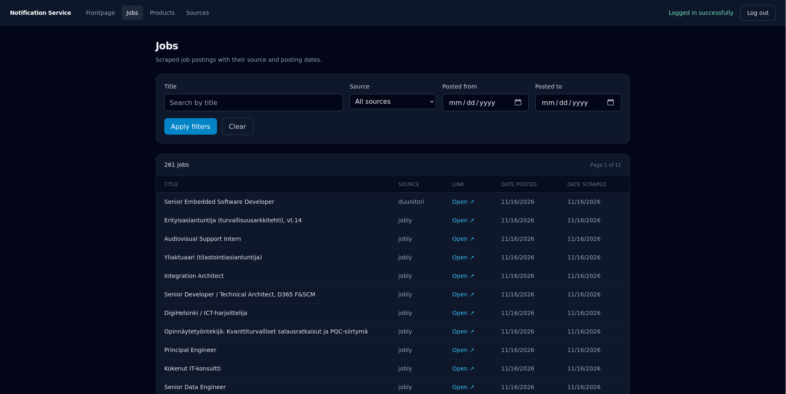
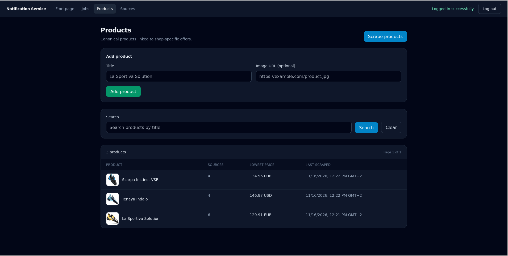

# Notification Service

A personal project for data scraping web sources and notifications service. Scrapes jobs from few different sources and has notification service via websocket when new job entries are added to database. For products support is for few different webshops mainly for outdoor product shops. Actual products and product sources are still inserted manually but will implement LLM based implementation in the future.
Build with FastAPI, SQLModel and Alembic.

## Websocket client
`scripts/notification-service.py` is a sample script for communication via websocket. Current notifications uses dunst but can be changed to any cli based notification.

## Screenshots

| Jobs | Products |
| --- | --- |
|  |  |

## Features
- Job scaping support for duunitori and Jobly
- Product scaping support for the following webshops
    - Varuste.net
    - Bergfreunde
    - Aminopörssi
    - EpicTV
    - Tradeinn
    - Hardloop
- Websocket support for admin user for showing notifications on new jobs. `scripts` folder includes a sample script for websocket client that can be used as a running service and send notifications via `dunst`
- Admin management for managing sources, products and webshop sources
- Product source error management with URL testing and correction
- Manufacturer and category tracking for products with separate lookup tables
- One-time JSON snapshot export and ingest for production
- Basic cli for managing sources
- curl_cffi tp bypass Cloudflare on source configs
- External proxy support to configs if Cloudflare has blocked by IP
- BeautifulSoup for HTML scraping
- Nix-shell for development


## Requirements

- Python 3.12+
- [uv](https://docs.astral.sh/uv/)
- PostgreSQL


## Setup

Install dependencies:

```bash
uv sync
```

Create the local environment file:

```bash
cp .env.example .env
```

Apply database migrations:

```bash
uv run alembic upgrade head
```

### Environment variables

| Variable | Default | Description |
| --- | --- | --- |
| `DATABASE_URL` | required | PostgreSQL SQLAlchemy database URL |
| `TEST_DATABASE_URL` | required for tests | PostgreSQL database URL used by the test suite |
| `ENVIRONMENT` | `development` | Environment name |
| `SQL_ECHO` | `false` | Log SQL statements when enabled |
| `APP_PASSWORD` | empty | Login password; also used as the external API key |
| `SESSION_SECRET` | `dev-insecure-change-me` | Secret used to sign session cookies |
| `SESSION_COOKIE_NAME` | `notification_session` | Name of the session cookie |
| `SESSION_MAX_AGE` | `2592000` | Session lifetime in seconds (30 days) |
| `SCRAPER_USER_AGENT` | `notification-service/0.1` | `User-Agent` header used for JSON scrape requests |
| `SCRAPER_IMPERSONATE` | `chrome` | Browser TLS fingerprint impersonated for HTML scrape requests; empty disables impersonation |
| `SCRAPER_HTML_USER_AGENT` | empty | `User-Agent` used for plain HTML requests (falls back to `SCRAPER_USER_AGENT`) |
| `SCRAPER_PROXY_URL` | empty | Optional HTTP(S) proxy for all scrape requests |
| `SCRAPER_HTML_PROXY_URL` | empty | Optional HTTP(S) proxy for HTML sources (falls back to `SCRAPER_PROXY_URL`) |
| `SCRAPER_TIMEOUT_SECONDS` | `15` | Timeout for scrape requests in seconds |
| `SCRAPE_INTERVAL_SECONDS` | `10800` | Job scrape slot interval during active hours; `0` disables the job scheduler |
| `SCRAPE_ACTIVE_START_HOUR` | `6` | First hour of the scheduler's active window in `Europe/Helsinki` |
| `SCRAPE_ACTIVE_END_HOUR` | `21` | Last hour of the scheduler's active window in `Europe/Helsinki` |
| `PRODUCT_SCRAPE_INTERVAL_SECONDS` | `86400` | Minimum age before a product offer is scraped again; `0` disables the product scheduler |

`APP_PASSWORD` is required when `ENVIRONMENT=production`, and `SESSION_SECRET`
must be changed from its development default.

Use `uv run` for all Python commands, or activate the project virtualenv first:

```bash
source .venv/bin/activate
```

Running bare `python` may use a different interpreter (for example, the Nix
shell Python) that does not have the project dependencies installed.

## Run the API

```bash
uv run uvicorn app.main:app --reload
```

Health endpoints:

- `GET /health`
- `GET /health/db`


## Manage sources

Sources can also be managed from the web UI at `/sources`, linked in the header
navigation. The page supports adding, editing, enabling/disabling, and deleting
both job and product sources. Scraper config is entered as a JSON object in a
text field. Deleting a source is blocked while product offers are linked to it.

Source configs

```bash
uv run python -m app.cli sources add \
  --slug jobly \
  --kind jobs \
  --adapter jobly_html \
  --url '<jobly-url>' \
  --config-json '{
    "http": {
      "client": "curl_cffi",
      "impersonate": "none",
      "user_agent": "curl/8.14.1",
      "proxy_env": "SCRAPER_HTML_PROXY_URL",
      "timeout_seconds": 30
    }
  }'
```

Create or update a source by slug with the CLI:

## Run scraping

Run one source:

```bash
uv run python -m app.cli scrape --source duunitori
```

Run all enabled sources of a kind:

```bash
uv run python -m app.cli scrape --kind jobs
uv run python -m app.cli scrape --kind products
```

### Scheduler

The FastAPI process runs a single in-process scheduler when
`SCRAPE_INTERVAL_SECONDS` or `PRODUCT_SCRAPE_INTERVAL_SECONDS` is positive.
It uses the `Europe/Helsinki` timezone and does not poll while waiting:

- Job scrapes run at slots from `SCRAPE_ACTIVE_START_HOUR` to
  `SCRAPE_ACTIVE_END_HOUR`, spaced by `SCRAPE_INTERVAL_SECONDS`. With the
  defaults, that is 06:00, 09:00, 12:00, 15:00, 18:00, and 21:00.
- Product scraping runs once per day together with the first morning job slot.
- No scheduler queries run during the night.
- If the process starts inside the active window, it runs one catch-up scrape
  and then continues with the normal slots.

Job and product scrapes share a lock, so scheduled runs skip and manual runs
wait when another scrape is active. Keep the API at one instance so the lock
remains effective.

The cron example below is an alternative for deployments that want to schedule
scraping outside the app. Do not run both cron and the in-process scheduler.

```cron
0 6,9,12,15,18,21 * * * cd /path/to/notification-service && /usr/bin/env uv run python -m app.cli scrape --kind jobs >> /tmp/notification-scrape.log 2>&1
0 6 * * * cd /path/to/notification-service && /usr/bin/env uv run python -m app.cli scrape --kind products >> /tmp/product-scrape.log 2>&1
```

Cron uses the host timezone. Set the server timezone to `Europe/Helsinki` or
adjust the hours accordingly.

## One-time product snapshot export and ingest

Product data is exported locally to a JSON snapshot and applied in production
without performing network requests.

```bash
# Local: export all products and offers to a snapshot
uv run python -m app.cli products export \
  --output data/products_all_sources.json

# Optional: limit the export to one source or manufacturer
uv run python -m app.cli products export \
  --source bergfreunde \
  --manufacturer la-sportiva \
  --output data/bergfreunde_products.json

# Production: apply the schema migration and ingest the snapshot
uv run alembic upgrade head
uv run python -m app.cli products ingest \
  --input data/products_all_sources.json
```

Use `--dry-run` with `products ingest` to validate the snapshot and roll back
all writes. The ingest is idempotent: products are matched by shop URL, existing
offers are refreshed, and manually edited product titles are preserved.

The snapshot format is version 3 and can contain offers from multiple product
sources. Legacy version 2 snapshots are still accepted. Snapshots exported
before category support (version 1) are rejected, so re-export before ingesting.

Without `--source`, `products export` includes every product source. These
commands are manual one-time tools and are not part of the schedulers or cron
examples above.

## Tests and linting

Tests require a PostgreSQL server. Set `TEST_DATABASE_URL` to a dedicated test
database; the suite recreates its schema and will refuse to run against the same
database as `DATABASE_URL`.

```bash
uv run ruff check .
uv run ruff format --check .
uv run pytest
```

## Architecture

```text
app/
  api/          FastAPI routes
  core/         application settings
  db/           engine, session, and metadata
  models/       Job, Source, Product, ProductSource, Manufacturer, Category models
  scrapers/     adapter protocols, HTTP helper, registry, source adapters
  services/     job/product repositories, scrape orchestration, schedulers
  cli.py        source management and scrape CLI
migrations/     Alembic migrations
tests/          unit and service tests
```

Scrape flow:

```text
Job:      Source row -> adapter registry -> ScrapedJob -> jobs table
Product:  Source row + ProductSource URL -> adapter registry
          -> ScrapedProduct -> product_sources table
```

### Database models

`jobs`:

- `external_id`
- `source`
- `title`
- `scraped_at`
- `date_posted`
- `raw_data`

`jobs` has a unique constraint on `(source, external_id)`.

`sources`:

- `slug`
- `kind` (`jobs` or `products`)
- `adapter`
- `url`
- `enabled`
- `config`
- `created_at`
- `updated_at`

For products, a Source is a webshop. Its `url` is optional because individual
product URLs live on `product_sources`.

`products`:

- `title`
- `image_url`
- `manufacturer_id`
- `category_id`
- `created_at`
- `updated_at`

`manufacturers`:

- `name`
- `slug`
- `created_at`
- `updated_at`

`categories`:

- `name`
- `slug`
- `created_at`
- `updated_at`

`product_sources`:

- `product_id`
- `source_id`
- `url`
- `external_id`
- `title`
- `image_url`
- `price`
- `currency`
- `availability`
- `sizes`
- `raw_data`
- `last_scraped_at`
- `last_error`
- `created_at`
- `updated_at`

`product_sources` has a unique constraint on `(source_id, url)`.


## Product aggregation and linking

A `Product` is the canonical product (for example La Sportiva Solution). Each
`product_sources` row links that product to a shop-specific URL and stores the
latest scraped price, sizes, availability, image, and raw data.

The product UI supports:

- creating canonical products with a title and optional image;
- linking and unlinking shop product URLs;
- viewing per-shop prices, sizes, availability, scrape times, and errors;
- viewing the lowest linked price and the union of sizes for a product;
- reviewing failed product offers at `/product-sources`, testing a corrected
  URL, and saving it without clearing existing scraped offer data.

The `/product-sources` page shows only offers with a `last_error` by default.
Use `Show all` to include healthy offers. Testing a URL fetches the candidate
page with the shop adapter and compares the scraped result to the linked
product using the stored external ID first, then a normalized title match.
Testing does not update the database; only `Save URL` clears the error.

Shop rows are managed with the CLI, for example:

```bash
uv run python -m app.cli sources add \
  --slug bergfreunde \
  --kind products \
  --adapter bergfreunde_html \
  --config-json '{"http": {"impersonate": "chrome"}}'
```
